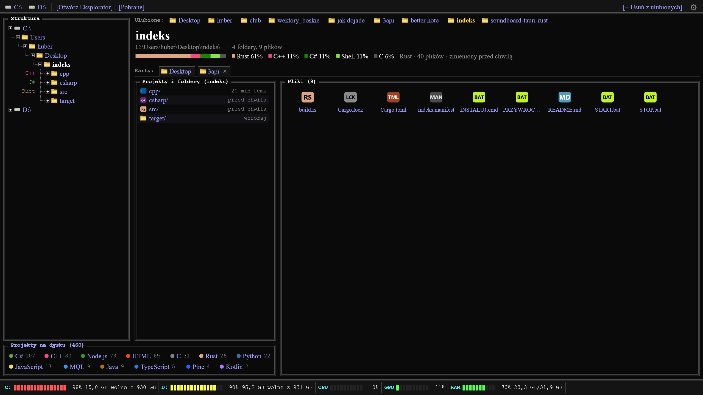
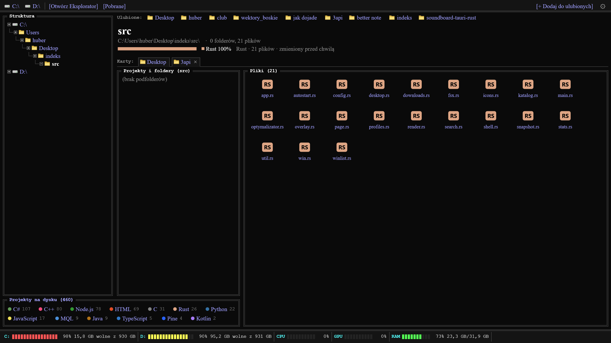
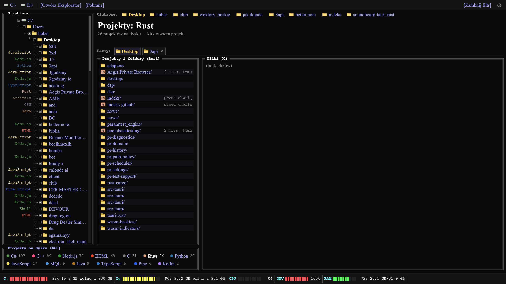
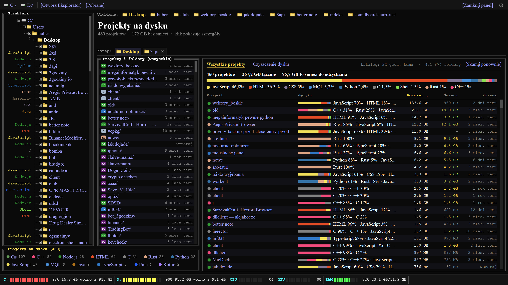
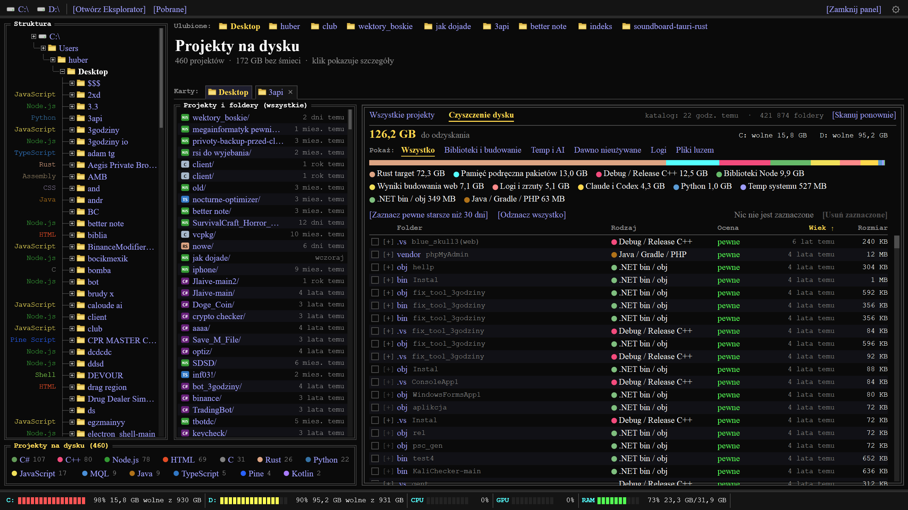
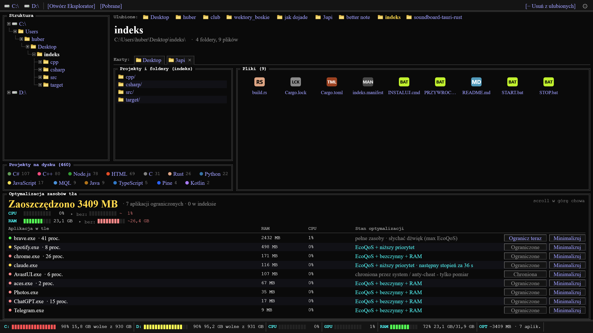

<div align="center">


<br>


<br>


<br>


<br><br>

<b>Indeks</b> · własny pulpit Windows &nbsp;—&nbsp; <b>Rust</b> · <b>C++</b> · <b>C</b> · <b>C#</b> &nbsp;·&nbsp; bez Electrona &nbsp;·&nbsp; bez lagów

<br><br>



</div>

<br>

## ◆ O projekcie

**Indeks** zastępuje ikony pulpitu Windows widokiem w stylu listingu katalogów z Chromium:
ciemnym, szybkim i czytelnym. Siedzi pod ikonami pulpitu, więc przeżywa **Win+D**, menu Start
i zmianę rozdzielczości. **Nie rusza żadnych plików**: chowa tylko ikony Explorera
i przywraca je przy zamknięciu.

Każda część jest napisana w języku, który do niej pasuje. **Rust** rysuje i podejmuje decyzje.
**C++** indeksuje dysk i szuka projektów. **C** mierzy i ogranicza procesy w tle.
**C#** wyświetla panel projektów i nakładkę nad grą. Każdy silnik to osobny program:
gdy któryś padnie, pulpit działa dalej.

<div align="center">

| Pamięć z indeksem | Wyszukiwanie | Odmalowanie | Okno Indeksu | Pomiar procesów |
|:---:|:---:|:---:|:---:|:---:|
| **~30–60 MB** | **2–6 ms** / 346 tys. plików | **~3,5 ms** | **~12 MB** | **~440 procesów** jednym zapytaniem |

</div>

<br>

## ◆ Co potrafi

<table>
<tr>
<td width="50%" valign="top">

**◇ Pulpit i nawigacja**
- **Ulubione** w jednej linii nad nazwą folderu
- **Struktura**: drzewo folderów z językiem każdego projektu
- **Projekty i foldery** z ikonami technologii i datą ostatniej zmiany
- **Pliki** jako siatka ikon powłoki, karty, osobne okna Indeksu
- **Nowe pobrane pliki** pojawiają się od razu

</td>
<td width="50%" valign="top">

**◇ Wyszukiwanie i projekty**
- Indeks całego profilu w **C++**: 346 tys. plików w ~15 MB
- Wyniki w **2–6 ms**, śledzenie zmian na żywo
- **Projekty na dysku** pogrupowane wg języka (jak pasek języków GitHuba)
- Rozpoznawanie technologii: `Cargo.toml`, `package.json`, `.sln`, `CMakeLists.txt`…

</td>
</tr>
<tr>
<td width="50%" valign="top">

**◇ Czyszczenie miejsca**
- Katalog śmieci projektów: `node_modules`, `target`, `bin/obj`, cache, logi
- Presety: *biblioteki i budowanie · temp i AI · dawno nieużywane · logi*
- Widać od razu, **ile miejsca można odzyskać** z każdego projektu
- Usuwa tylko pozycje z katalogu, połączeń (junction) nie dotyka

</td>
<td width="50%" valign="top">

**◇ Optymalizacja zasobów tła**
- Aplikacja = okno **+ całe drzewo podprocesów** (renderery, GPU, helpery)
- Także programy schowane do **zasobnika** (bez okna)
- **EcoQoS**, priorytet, priorytet pamięci, zwalnianie RAM, zawsze stopniowo
- Grająca muzyka czy rozmowa dostaje najwyżej EcoQoS
- Terminale, serwery i buildy **nietykalne**, powrót na wierzch = pełne zasoby

</td>
</tr>
<tr>
<td colspan="2" valign="top">

**◇ Pasek wydajności i nakładka**: dyski · CPU · GPU · RAM na dole pulpitu, przyciski otwartych aplikacji,
a nad grą na pełnym ekranie **półprzezroczysta nakładka**, przez którą kliknięcie trafia do gry.
Scroll w dół na pasku rozwija zakładkę optymalizacji: **teraz** obok **„bez optymalizacji”**.

</td>
</tr>
</table>

<br>

## ◆ Technologie: kto za co odpowiada

<div align="center">

| Język / API | Program | Za co odpowiada |
|:---|:---|:---|
| **Rust** · `windows-rs` | `indeks.exe` | okna Win32, osadzenie w `WorkerW`, układ, logika, decyzje optymalizatora |
| **Direct2D · DirectWrite** | `indeks.exe` | rysowanie programowe w pasach 256 px, częściowe odmalowanie, ClearType |
| **C++** | `search.cpp` (FFI) | indeks plików i wielowątkowe wyszukiwanie, profil projektu |
| **C++** | `indeks-katalog.exe` | skan projektów i śmieci na całym dysku, usuwanie |
| **C** · NT API · WASAPI | `indeks-optymalizator.exe` | procesy z jądra, EcoQoS, priorytety, RAM, miernik dźwięku |
| **C#** · WinForms | `indeks-panel.exe` | panel *Projekty na dysku* i *Czyszczenie*, osadzony w oknie Rust |
| **C#** · okno warstwowe | `indeks-nakladka.exe` | CPU / GPU / RAM nad grą na pełnym ekranie |
| **PDH** | `indeks.exe` | liczniki CPU i „GPU Engine 3D” |
| **Shell API** | `indeks.exe` | ikony powłoki, menu kontekstowe, start programów przez Explorera |

</div>

> Rust rozmawia z silnikiem C **na żywo przez potok** (komenda → jedna linia odpowiedzi).
> C ma bezpiecznik: gdy Indeks zniknie, sam cofa wszystkie ograniczenia.
> Wyłącznie oficjalne API Windows, **bez wstrzykiwania kodu** do innych programów.

<br>

## ◆ Struktura projektu

```text
indeks/
│
├── src/                      ── Rust · okna Win32, rysowanie, logika
│   ├── main.rs               start i polecenia (--okno, --nowe-okno, --zrzut…)
│   ├── win.rs                pulpit, okna Indeksu, komunikaty, nakładka
│   ├── app.rs                stan widoku: drzewo, projekty, pliki, karty, ustawienia
│   ├── render.rs             Direct2D / DirectWrite, rysowanie w pasach 256 px
│   ├── page.rs               model strony i układ paneli
│   ├── desktop.rs            osadzenie pod ikonami pulpitu (WorkerW / Progman)
│   ├── search.rs             indeks plików (FFI → C++), śledzenie zmian na żywo
│   ├── profiles.rs           silnik projektów: technologia, języki, daty
│   ├── katalog.rs            obserwator dysku → katalog projektów (C++) i panel (C#)
│   ├── optymalizator.rs      mózg optymalizacji: grupy procesów, stopnie, dźwięk
│   ├── icons.rs              ikony powłoki i plakietki technologii
│   ├── shell.rs              start programów przez Explorera, menu kontekstowe
│   ├── winlist.rs            otwarte aplikacje, wykrywanie pełnego ekranu
│   ├── stats.rs              CPU · GPU · RAM · dyski
│   ├── downloads.rs          nowe pliki w folderze Pobrane
│   ├── overlay.rs            zapasowa nakładka w Rust
│   ├── snapshot.rs           zrzuty widoku bez okna
│   └── config.rs · autostart.rs · fsx.rs · util.rs
│
├── cpp/                      ── C++ i C · silniki
│   ├── search.cpp · search.h       indeks ~346 tys. plików w 15 MB, wyszukiwanie
│   ├── katalog.cpp · katalog_skan.cpp · katalog.h
│   │                               katalog projektów i śmieci (--pelny / --odswiez / --usun)
│   └── optymalizator.cpp           pomiar i ograniczanie procesów tła (potok z Rustem)
│
├── csharp/                   ── C# · widoki
│   ├── Panel.cs · PanelDane.cs · PanelRysuj.cs   projekty na dysku i czyszczenie
│   └── Nakladka.cs                               nakładka nad grą
│
├── docs/
│   ├── zrzuty/               zdjęcia do README
│   └── SZCZEGOLY.md          notatki techniczne
│
├── build.rs                  kompiluje C++ (cl), C (cl) i C# (csc), osadza manifest DPI
├── Cargo.toml
├── INSTALUJ.cmd              instalacja jako pulpit (bez administratora)
├── START.bat · STOP.bat      uruchomienie / zatrzymanie (ikony Windows wracają)
└── PRZYWROC_PULPIT.cmd       powrót do zwykłego pulpitu + wyłączenie autostartu
```

<br>

## ◆ Z aplikacji

<table>
<tr>
<td width="50%" align="center">

<br><sub><b>Folder projektu</b>: struktura, projekty, pliki</sub>
</td>
<td width="50%" align="center">

<br><sub><b>Projekty wg języka</b>: jedno kliknięcie w język</sub>
</td>
</tr>
</table>

<br>

## ◆ Projekty na dysku



Wszystkie projekty z całego dysku w jednym miejscu: język, technologia, rozmiar, ostatnia zmiana.
Katalog buduje **C++** (`indeks-katalog.exe`), **Rust** pilnuje zmian na dysku, a **C#** wyświetla.

<br>

## ◆ Ile miejsca możemy odzyskać



Biblioteki, foldery budowania, cache, pliki tymczasowe AI, logi i projekty nieruszane od miesięcy,
każde z wyliczonym rozmiarem. Najpierw widać, **ile odzyskasz**, a dopiero potem usuwasz.

<br>

## ◆ Oszczędzanie zasobów tła



Przeglądarka, komunikator czy gra w tle to dziesiątki podprocesów. Indeks liczy je razem,
a po zminimalizowaniu ogranicza je **stopniowo**:

<div align="center">

| Stopień | Kiedy | Co robi |
|:---:|:---|:---|
| **1** | ~45 s w tle · okno przykryte od 3 min · gra dźwięk | EcoQoS + niższy priorytet + średni priorytet pamięci |
| **2** | kolejny odcinek w tle | priorytet bezczynny + bardzo niski priorytet pamięci + zwolnienie RAM |
| **3** | dalej w tle | ponowne zwolnienie RAM, gdy znów urośnie |
| **0** | wraca na wierzch | **natychmiast pełne zasoby**, oryginalny priorytet |

</div>


